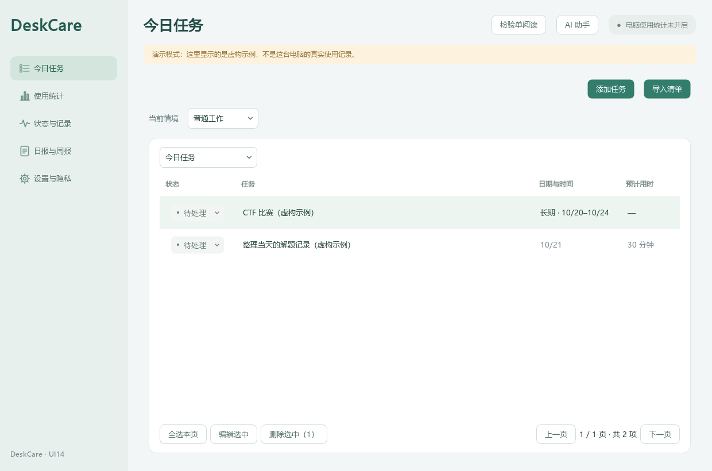
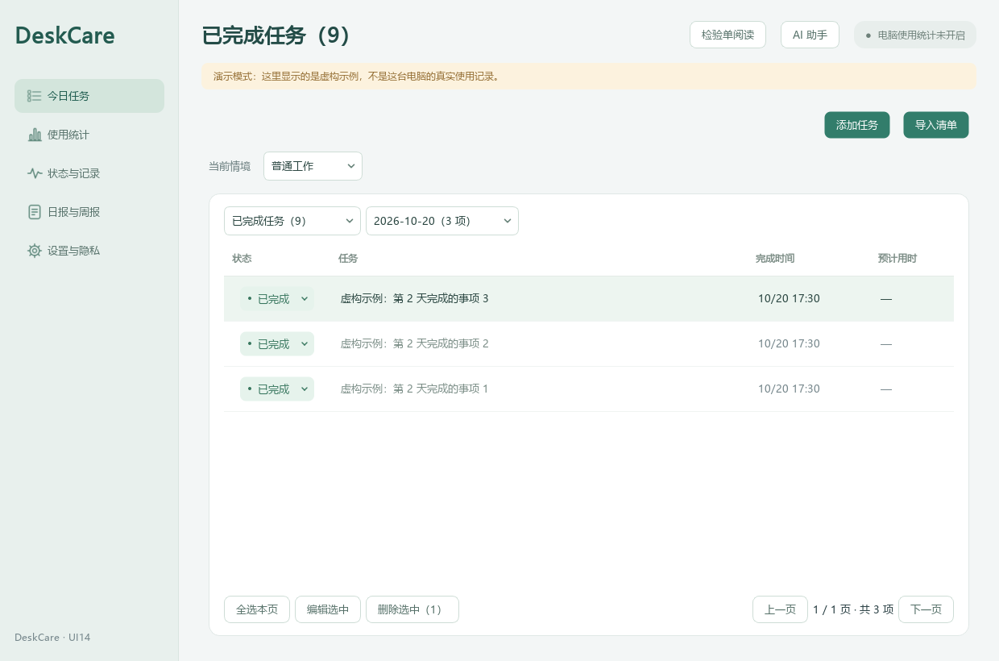
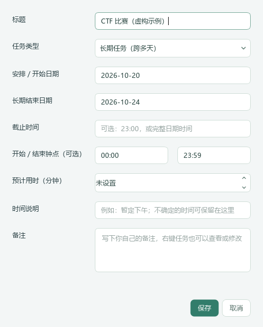

# DeskCare UI14 任务优化

## 启动

Windows 下载包完整解压后运行 DeskCare-UI14.exe，不要单独移动 exe 或删除 _internal。START-DEMO.cmd 使用独立的虚构演示数据。先从托盘正常退出旧版，再运行新版，避免单实例机制切回旧界面。程序未签名，不建议全局关闭安全防护。

## 已完成任务

今日任务只保留未完成项目。标为已完成后，任务保留在“已完成任务”中，按完成时间从新到旧排列，可通过日期选择器查看某一天；不是按原安排日期归档。旧数据没有完成时间时单独显示“完成日期未记录”，不补猜日期。

在已完成列表里可编辑、批量选择、删除，或把状态改回待处理／进行中。撤销完成后，任务按原安排回到今日或后续任务。重复设置为已完成不会改变第一次记录的完成日期。

## 长期任务

添加／编辑时选择“长期任务（跨多天）”，填写开始与结束日期，例如 CTF 比赛 2026-10-21 至 2026-10-25。每天看到的仍是同一条任务，不会复制，也不自动标为完成。结束日期包含当天；结束后未完成的任务继续留在今日，方便收尾，不静默丢弃。

开始／结束钟点可省略；它们描述活动范围，不自动变成截止闹钟或实际投入时长。若要明确截止，请另填截止时间。仅输入截止钟点时，长期任务会使用结束日期。详情中能看完整日期范围和独立截止信息。

支持导入明确的完整日期范围，例如 `CTF 比赛（2026-10-21 至 2026-10-25）`。没有明确日期不从比赛名称猜测时间。清单仍需预览确认后才保存。单日任务、已有备注和数据继续兼容，不新增数据库表。

## 数据和旧版

旧版运行包／提交包归档到 GitHub 独立历史发布，验证全部分包服务端 SHA256 后再清理本机。源码、当前 UI14、个人数据库、开发环境与 build／测试缓存不在自动删除范围。恢复方法见“历史版本归档说明”。

源码与下载入口：https://github.com/firefelixfu026/DeskCare

## 界面示例

以下为当前程序用虚构数据渲染的页面，不是个人真实记录。

