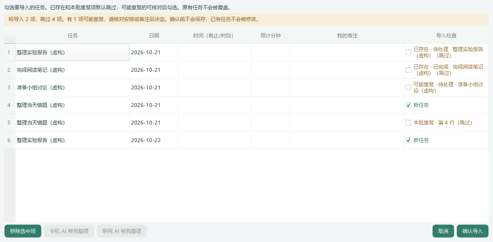

# UI15｜导入清单时检查重复任务

完整解压 `DeskCare-UI15-Windows-x64.zip`，退出旧程序后运行 `DeskCare-UI15.exe`。`START-DEMO.cmd` 使用隔离的虚构演示数据。不要单独移动 EXE；此体验包未签名。

## 导入时会发生什么

选择清单后，“导入检查”会与本机全部任务比对，包括待处理、进行中、后续和已完成任务，不依赖文件名。换一个文件名或再次请 AI 整理，不会跳过这道检查。

- **新任务**：默认勾选，确认后新增。
- **已存在／本批重复**：默认跳过，原行仍保留可查看、修改。不会覆盖原任务，也不会把已完成任务重新变成待处理。
- **可能重复**：例如名称很接近、缺少原有截止时间，或带来不同的备注／明确预计用时。默认不勾选；核对后可以勾选为独立新任务，也可以先修正日期或名称。

名称会统一全半角、英文字母大小写和多余空白。明确不同日期、不同场次和不同长期起止范围的同名事项会分别保留，不按标题一刀切。没有日期、时段或语义不清时，不会自动合并。AI 给出的不同预计用时不是新建重复任务的依据。

勾选后点击“确认导入”才会保存；取消不更改数据库。保存前会在同一事务中再次检查明确重复项，防止预览期间其他入口已添加相同事项。此功能不会清理以前已经存在的重复任务；有意创建完全相同的事项仍可用手动添加。

## 联网 AI 也走相同流程

解析提示要求同日同场次的同一事项只输出一次，同时保留不同日期／场次。AI 返回后在本机重新核对，模型失败仍保留原草稿。已有任务库不会为了去重额外发送给模型；仍只发送本次选择、逐次预览确认的清单。没有联网 AI 时也可去重。

图中已有任务与已完成事项跳过；可能重复项可核对后勾选；本批同一事项只选一条；另一天的同名任务保留。全部为虚构数据。

## 验证边界

自动化覆盖规则导入、模拟 AI 结果、取消、编辑后重查、重复保存、并发导入、事务回滚、跨日／长期和原状态保留。与原清单匹配的 AI 候选保留原任务名称。名称中的增减词仅作待核对线索，不是语义等价结论；不能保证识别所有别名或语义重复。真实 DeepSeek 输出质量、原生 Windows 焦点／多屏及干净机仍需人工验收。当前更新不增加数据采集、健康记录或上传权限。
