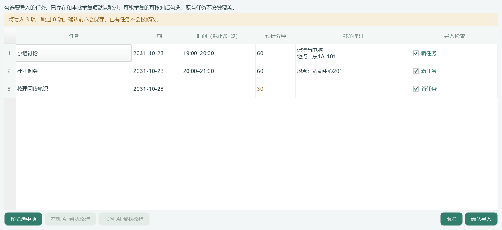

# UI16｜AI 整理活动地点

本机保留可直接运行的最新版：`dist/DeskCare-UI16/DeskCare-UI16.exe`。项目根目录的 `Start-DeskCare.cmd` 指向此版本；以后更新时同步这个入口，不要求本机使用者再次下载。请先从托盘退出旧版；不要单独移动 EXE。

## 地点放进备注

联网／本机 AI 整理清单时，可以提取条目明确写出的教室、场馆、地址或线上平台，放入可编辑的备注，例如：

原文：`小组讨论（19:00-20:00）（地点：东1A-101）`

整理后：任务“小组讨论”，时段“19:00–20:00”，备注“地点：东1A-101”。原文的安排日期、截止时间、时段和明确预计用时优先保留，不由地点提取改动。

你已填写的备注保留，地点另起一行补入；再次整理不会把同一地点反复追加。预览中仍可直接修改或删除，确认后才保存。备注过长会要求精简，不静默截断。任务导入后也可通过既有右键备注入口查看和修改。

## 不猜地点、不串场

模型需要返回地点原文和该任务的原文行号。应用只接受可逐字对应到该条内容的地点，并与源任务核对后再拆分；缺行号时只接受原文唯一出现的地点。错误行号、不存在的地址、多个条目同一地点但无法确定归属时，不擅自填入。原任务和原文中仍保留的信息不会因此被删除。

这不是地图检索、导航或地址纠错，不补楼栋、不猜教室，也不能保证识别任意别名、跨行说明或复杂表格。地点是 AI 识别草稿，确认前仍需核对。未配置 AI 的规则导入仍可用，不把它说成模型识别。

## 去重与隐私

仍执行 UI15 的已有任务／本批去重和保存时重查。旧版曾把地点保留在标题中的事项，拆出地点后也会提示可能重复，不自动覆盖旧任务或备注。新增地点备注与旧资料不一致时由用户复核，不假装已更新历史记录。

联网仍只发送本次主动选择、逐次预览确认的清单；不追加已有任务库、个人备注、活动轨迹或健康资料，不查外部地图。没有新权限、新数据库表或后台上传。

图为虚构清单和模拟模型输出，用来展示地点进入备注、时间分栏及个人备注保留，不是用户资料或真实模型效果证据。

## 分发

GitHub Windows 包为 `DeskCare-UI16-Windows-x64.zip`，给其他设备使用时完整解压后启动，附 `START-DEMO.cmd` 隔离演示入口。本包未签名，不应为此全局关闭安全防护。已在本机生成的完整程序无需再次下载。

自动化及包内一致性检查记录见 `PROGRESS.md`。真实 DeepSeek 识别质量、原生 Windows 焦点、多屏和干净机体验仍需实际核对；不以模拟传输替代真实服务验收。
