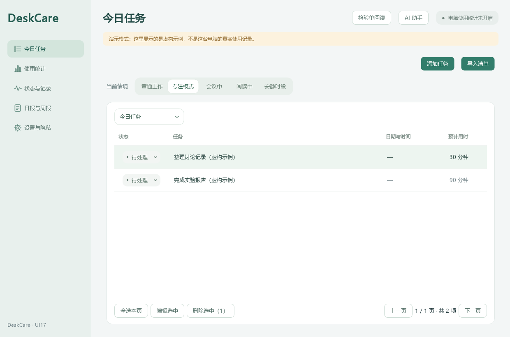
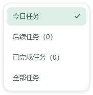
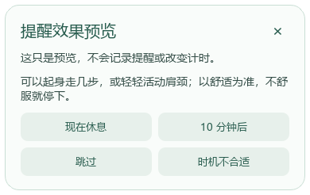

# UI17｜柔和选择控件与完整提醒反馈

本机最新版保留于 `dist/DeskCare-UI17/DeskCare-UI17.exe`，项目根目录 `Start-DeskCare.cmd` 已同步，不需要重复下载。先从托盘退出旧版再启动；不自动结束用户程序。

## 不再统一使用方形下拉框

当前情境改为平铺的分段按钮：普通工作、专注模式、会议中、阅读中、安静时段。选中状态用白色圆角滑块和柔和底色表达。每天／每周、日报／周报也可直接切换。

任务范围、完成日期、AI 服务、状态、任务类型等列表仍适合下拉，但已改为自绘的圆角白色浮层、浅绿选中背景、圆角勾选和轻阴影，不再使用原生直角外框。长列表可滚动，并限制在当前屏幕可用区域。桌面伙伴紧凑面板使用同一套下拉样式，任务状态菜单也换成圆角透明外壳。

保留原来的数据、保存和同步语义。鼠标及键盘可操作；下拉用方向键浏览、Enter 确认、Escape 取消，取消不改选项。滚动页面不会顺带改变选项。模型／助手更新情境时，即使页面为避免回写而临时阻断信号，分段按钮仍跟随实际值更新。

## 桌面提醒缺少第四项的问题

用户指出实际桌面弹窗只有三个按钮。核对后发现：后台支持 BAD_TIMING，主页面也有相应按钮，但桌面弹窗没有该入口。先前只解释后台计数，没有核对完整的用户入口；本次补齐桌面弹窗，并用真实 Qt 点击连接到临时数据库验证。

现在四个选项为：

- **现在休息**：记录本人表示打算休息，不推断已经休息。
- **10 分钟后**：记录推迟，并按已有规则稍后提醒，不算明确时机不合适。
- **跳过**：单独统计跳过，不算明确时机不合适；右上角关闭仍归为跳过。
- **时机不合适**：明确的时机反馈，增加该项计数。

## 连续推迟也参与复核，但不混算

按用户选择的方案，设置页和主动 AI 分析中将推迟、跳过、明确不合适分开显示；旧记录不会重分类。开启“根据提醒反馈，建议我调整间隔”后，同一情境最近连续 **3 次**选择“10 分钟后”，会建议复核频率；单次推迟、被其他回应打断的序列不触发这一提示。

这是独立的较弱线索，不称为“用户认为时机不合适”，更不判断身体状态。复核仍只建议、不自动改间隔；用户可暂不调整。处理后等至少 **5 条新的同情境回应**再复核，避免同一批反馈反复提示。间隔建议沿用有限上限：短测试值回到既有常规候选，其他情况温和增大、最多 180 分钟，不改变会议／静默／暂停规则。已有明确不合适反馈的足量比例规则保持不变。演示数据和未授权反馈建议不触发自适应复核。

AI 只在原有独立许可、逐次确认流程中参考最小汇总，新增的推迟／跳过次数不混入明确不合适计数；不自动联网、读取健康历史或屏幕。

## 验证与分发

四幅界面均为虚构任务或预览，不作为真实模型、健康效果或原生窗口验收证据。测试覆盖圆角透明边缘、真实列表点击／键盘确认取消、长列表／禁用项、分段同步／动画、四项桌面点击到数据库，以及连续推迟的授权、情境和去重提示。具体命令和结果见 `PROGRESS.md`。

Windows 完整包可同步到 GitHub 供其他设备使用，包含 `START-DEMO.cmd` 隔离演示入口；本机完整程序不会因发布而删除。本包未签名，不应为此全局关闭安全防护。真实 Windows 焦点／多屏切换／屏幕边缘的原生行为仍需人工验收。
