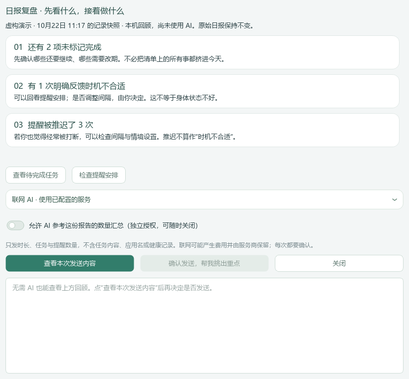
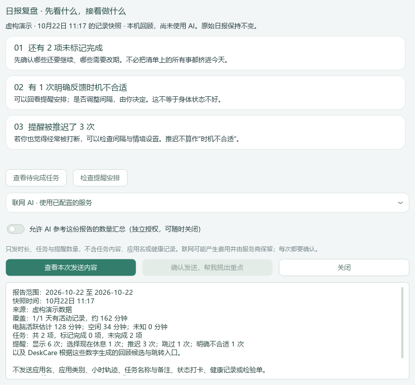
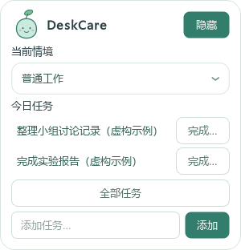
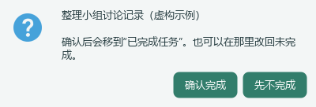

# UI18｜日报复盘与悬浮任务防误触

本机完整程序：`dist/DeskCare-UI18/DeskCare-UI18.exe`。根目录 `Start-DeskCare.cmd` 已同步；不需要重新下载。启动前请从托盘正常退出旧版，不会强制结束用户程序。

## 从“换个说法”改为“接下来做什么”

原“AI 帮我润色”仅接本机模型，配置联网服务也不会启用；生成摘要后又拼上整篇基础报告，信息重复。本次改为“回顾与下一步”：原始日报不变，打开独立复盘窗口。

根据这份报告的真实数量，呈现未完成事项、明确不合适反馈、反复推迟、记录覆盖等回顾卡片，并提供“查看待完成任务”“检查提醒安排”“查看使用统计”。只是跳转，不会替你改任务或间隔。没有 AI 时也有本机回顾。

AI 的作用是从符合当前数据的候选中挑出最多三项优先回看内容和最多两个下一步入口，而不是再改写一遍全文。它不了解未提供的任务内容，不能判断具体任务难度或代替个人决定。文字和数字由程序根据事实呈现，不允许模型编造健康结论、工作效率或实际休息效果。

## 可以用已配置的联网 AI，但许可单独管理

打开“回顾与下一步”，选联网或本机 AI，再打开独立授权。点击“查看本次发送内容”，核对中文清单、目标地址和模型，最后点“确认发送，帮我挑出重点”。默认不授权，预览与开启本身都不联网、不读取密钥。

只提供所选日报／周报的日期范围、是否演示、覆盖天数、活动／空闲／未知分钟总量、任务数量和提醒各项计数，以及由这些数字生成的复盘候选。**不发送**小时轨迹、应用名或类别、任务名称与备注、打卡、不适记录、检验资料。服务密钥仅用于请求认证，不在正文或中文预览中。联网内容可能收费并被服务商留存，已发送的内容无法撤回。

许可名 `report_review_ai`，默认关闭，不继承任务整理、提醒分析、助手或健康许可；可以在复盘窗口随时关闭。复盘只保留在窗口内存，不保存新的 AI 历史。预览单次使用、五分钟内有效；切换服务、撤回许可、关闭窗口、切换报告类型、主动刷新及全部清除会使旧请求／结果失效。正常后台记录更新不把新数据偷偷加入已选快照。AI 超时、断网、格式无效时保留本机回顾和原始日报。

## 悬浮窗不再一点就完成

点任务标题只打开只读详情，可以看完整名称、安排、截止、预计用时和自己的备注，不改变状态。右侧“完成…”独立放置，点击后还需“确认完成”；默认和 Escape 都是先不完成。确认后才转到按日期归类的已完成列表，可在主界面改回未完成。弹窗期间任务若已被其他入口修改或删除，不覆盖新状态；不会把长期任务按天自动完成。

## 验证边界

截图来自临时虚构数据库及 Qt 离屏渲染，没有请求真实模型、读取个人库或密钥。自动化覆盖数量白名单、独立授权、逐次确认、重复发送、内容／配置变更、撤回后的迟到结果、失效快照、严格响应校验、主线程更新、离线回退，以及任务只读查看／取消／确认完成。实际命令、全量结果和包核对见 `PROGRESS.md`。

本机完整最新版与 GitHub Windows ZIP 同步保留。包未签名，请勿为此全局关闭安全防护。真实 DeepSeek 的优先级质量、Windows 原生焦点／多屏／干净机行为仍需本人确认后体验，不用模拟结果冒充实际效果。
