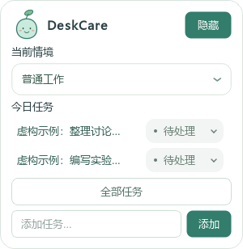
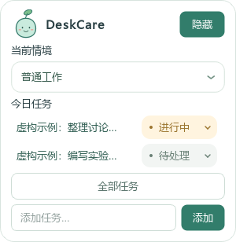

# UI19｜悬浮窗也能直接选择任务状态

本机完整最新版在 `dist/DeskCare-UI19/DeskCare-UI19.exe`，固定 `Start-DeskCare.cmd` 已同步，不需要重新下载。请先从托盘正常退出旧版，不会强制结束用户程序。

## 不再弹“完成确认”框

UI18 将标题查看与完成操作分开，但悬浮窗是置顶 Tool 窗口，普通完成确认框未带相同置顶标记，用户截图中被伙伴盖住。按本轮用户要求，移除该确认框，不再用弹窗完成任务。

现在右侧和主页面一样，是圆角状态菜单：**待处理／进行中／已完成**。打开菜单、方向键浏览、Escape 取消不写入；鼠标选中或 Enter 确认后保存。选进行中会显示浅黄色状态，选已完成才移到主页面按日期分类的已完成列表，可在那里改回未完成。点击任务标题仍只查看详情，不改状态。

## 层级与同步

状态菜单只在所属窗口置顶时附带置顶标记，主页面普通窗口的菜单不强制置顶。只读详情也匹配伙伴的置顶层级。菜单先关闭再保存，避免同步刷新时还留着旧浮层；任务被外部更新、删除或列表重建时关闭旧菜单，不用旧状态覆盖新状态。完成只通知一次既有提醒协调器，不改变长期任务、统计、健康或模型权限。

## 验证情况

全量 **467 项通过**，150% 相关回归 **36 项通过**。验证真实 Qt 菜单鼠标点击、键盘确认、取消／同状态不保存、进行中显示、完成归档、失效任务、标题只读、标签宽度及置顶标记隔离。截图全部是虚构任务和离屏 Qt 渲染，不含个人资料。

使用 computer-use 技能尝试原生 Windows 走查。纯 Tool 测试窗未出现在工具可定位列表，随后增加正常父窗口并成功定位，但激活／截图停在电脑操作授权超时；未继续输入或操作其他程序，隔离窗口四分钟自动退出。因此不声称真实桌面遮挡、原生焦点、多屏或干净机已验收。下一步是用户从本机固定入口确认新菜单表现。构建、哈希和发布证据见 `PROGRESS.md`。
