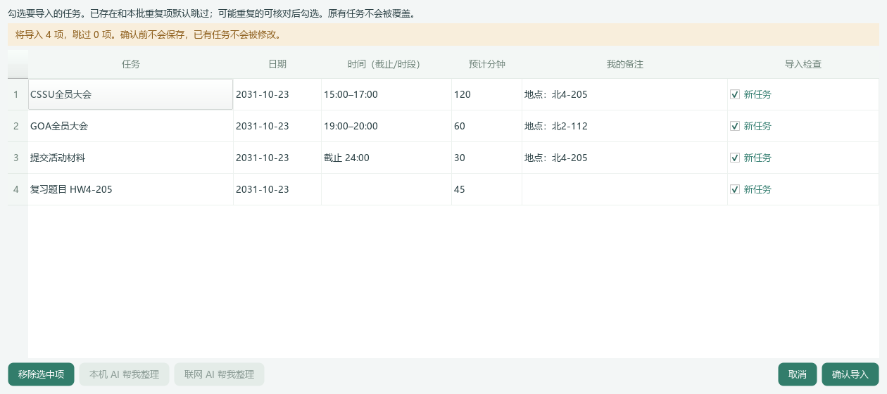

# UI20｜教室编号不再完全依赖 AI

本机完整最新版在 `dist/DeskCare-UI20/DeskCare-UI20.exe`，固定 `Start-DeskCare.cmd` 已同步，不需要重新下载。先从托盘正常退出旧版；不会强制结束程序或改动原有任务。

## 修复了什么

用户反馈“CSSU全员大会（北4-205）”“GOA全员大会（北2-112）”仍夹在标题中，备注空白。旧实现只接受模型返回的 location，且要求原文逐字匹配并能对应活动行；模型漏填、扩写或给错行号都会使地点未入备注。

本次在本机规则解析中补充方向楼栋＋房间号的窄范围识别，不再只等 AI 返回字段。支持活动括号、分隔符、空格或明确地点前缀中的“北4-205”“北2-112”“东1A-101”等；支持相应全角数字、连接符，原样保存编号，不扩写楼栋名称、查询地址或推测校区。

- `CSSU全员大会（北4-205，15:00-17:00）` → 标题 `CSSU全员大会`，备注 `地点：北4-205`，时段 `15:00–17:00`，用时 `120` 分钟。
- `GOA全员大会（北2-112）（19:00-20:00）` → 标题 `GOA全员大会`，备注 `地点：北2-112`，原时间保留。

## 离线与 AI 流程保持一致

TXT／Markdown 先分离明确教室再解析时间，避免地点清理破坏单个钟点、24:00、活动时段和长期日期范围。CSV／XLSX 的 title 也用同一规则，不覆盖原截止或预计分钟字段。AI 合并以本条原文识别出的教室为准：即使模型不填、改成“北4-205教室”、引用别行地点或错误行号，也不会替换本条已识别的原文教室。泛化地点仍按原来的逐字／归属校验处理，不能把不在该条原文的地址填入。

本机与联网提示补上教室编号及正反例，仍只发送用户原先选择且逐次确认的清单，不添加已有任务库、活动或健康资料，不增加模型调用或自动重试。下图由模拟模型漏填／改写结果生成，不代表已调用真实 DeepSeek。

## 不盲目猜测

日期、钟点、预计分钟、HW4-205 等作业号不作为地点；明确编号／题号／工单／型号／版本和否定表述不自动拆分。同一条有多个教室、连写无法区分、未知地点或只拿房间当任务名时，保留信息供手动核对。并非任意校园简称都能可靠识别。

备注提示区分“本机从原文分离”与“AI 摘录”，可直接修改或删除；个人备注继续合并保留，不重复追加同一地点，不截断超长备注。确认导入才入库，取消无写入，原有任务不覆盖；重导继续检查重复。旧任务标题还带地点时提示可能重复，避免当成全新任务悄悄再导一份。

## 验证边界

全量 **522 项通过**，150% 地点／导入界面／时间统计回归 **99 项通过**。覆盖离线与模拟 AI、错误行号／改写／幻觉、原文字符、日期和时间、长期任务、CSV／XLSX、个人备注、预览确认及重复导入。普通和 150% 两幅虚构图均逐张检查。

没有读取个人数据库、密钥或真实健康资料，没有付费或真实模型请求，也没有启动个人实例。真实 DeepSeek 在其他写法上的提取质量、Windows 原生焦点／多屏／干净机仍需用户体验；本次窄规则的正确性不依赖模型是否返回 location。构建、哈希及命令见 `PROGRESS.md`。Windows 包未签名，请勿全局关闭安全防护。
