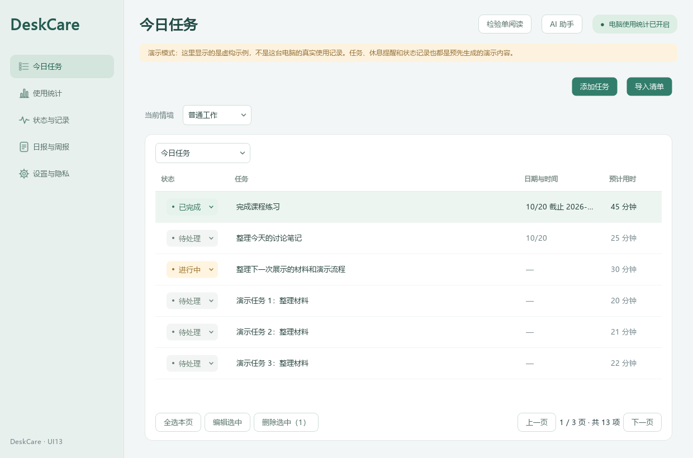
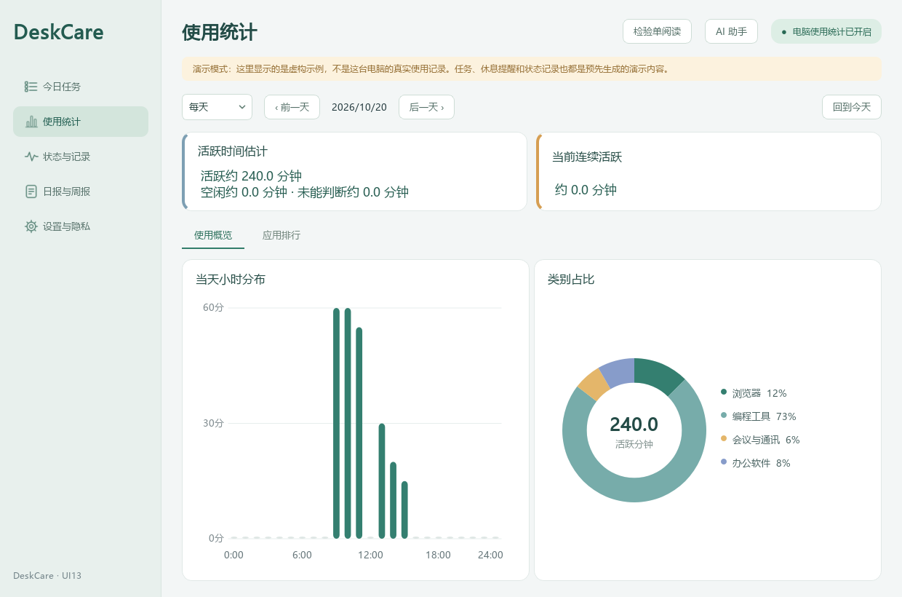
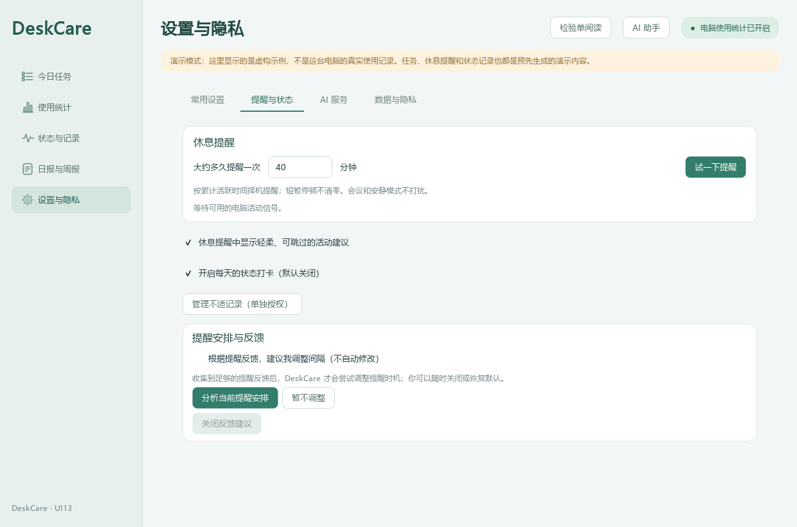
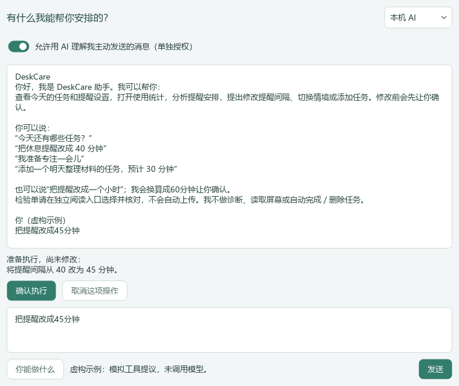
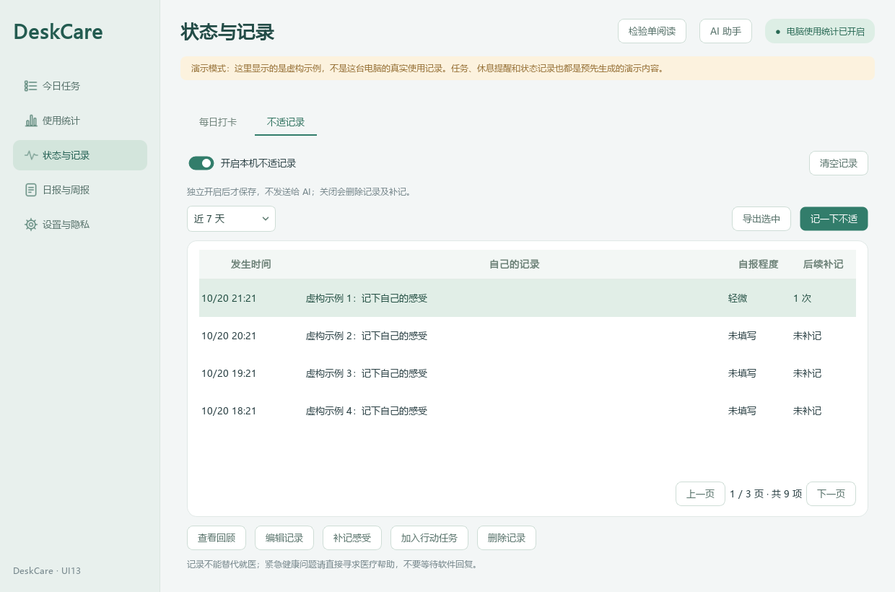
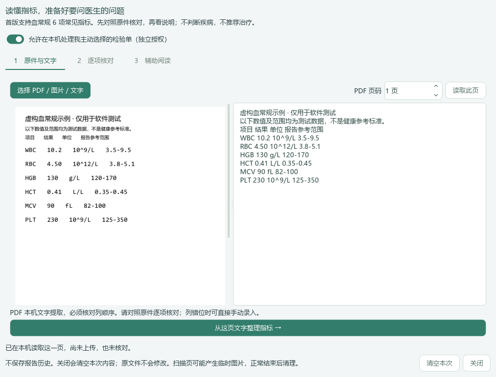
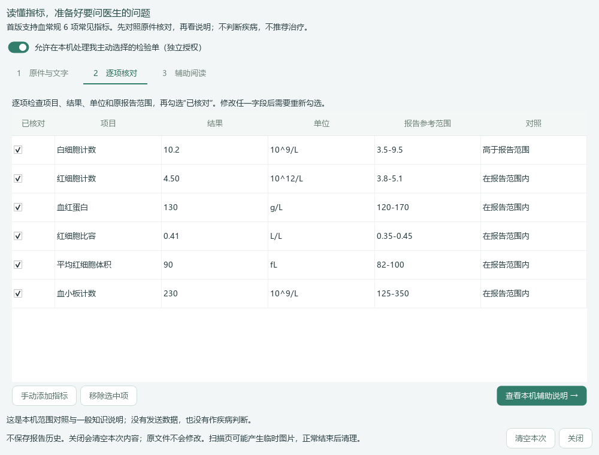
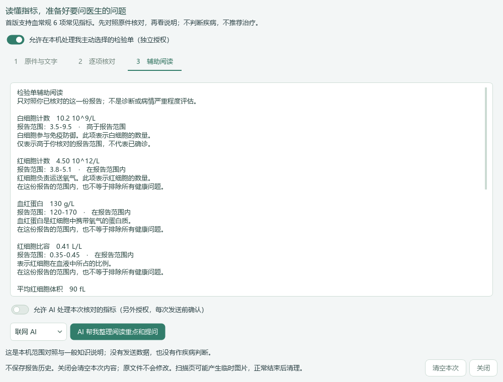

# DeskCare 产品演示

DeskCare 是轻量化个人 AI 健康小助手：安排任务、照顾使用节奏、主动记录感受，帮助阅读检验单和准备就诊问题。

[下载 Windows 体验版](https://github.com/firefelixfu026/DeskCare/releases/tag/v2.0.0-ui13) · [商业计划书](DeskCare_商业计划书_UI13.md)

## 今日安排

今日与后续任务分开显示，支持分页、批量选择、状态调整和备注。清单导入先预览、再确认保存。

## 看清使用节奏

每天、每周和小时视图帮助回顾电脑使用情况，支持切换历史日期；类别占比与应用排行放在同一入口。

## 提醒由自己掌握

间隔可自行填写，会议和安静情境减少打扰。提醒可选择休息、稍后或跳过，反馈可用于复核安排。

## 自然语言助手

用平常的话查看任务、提出修改提醒或切换情境。改变设置前，展示具体操作供用户确认。这张截图展示操作提议界面，提议为演示填充，不代表真实模型推理结果。

## 主动记录身体感受

本人选择是否记录，也可补记变化、加入自己决定的行动任务。记录保留在本机，不自动交给 AI。

## 检验单先核对再阅读

选择 PDF、图片或文字，在本机提取；原页与文字并排显示，便于发现错字或错列。

核对项目、数值、单位和报告参考范围后，再查看血常规常见项说明。缺失信息不猜测，也不把范围内外当成诊断。

辅助阅读解释一般含义，列出可带给医生的问题，并提供说明来源；AI 处理另行授权，每次先确认发送范围，不自动上传原件。

## 可选桌面伙伴

简洁悬浮窗与吉祥物可切换。表情对应用户主动选择的状态，不是程序检测到的健康情况。

以上均为当前程序用虚构数据渲染的界面，未展示个人任务、真实检验资料或密钥。产品提供健康信息整理与日常支持，不代替医生诊疗。
